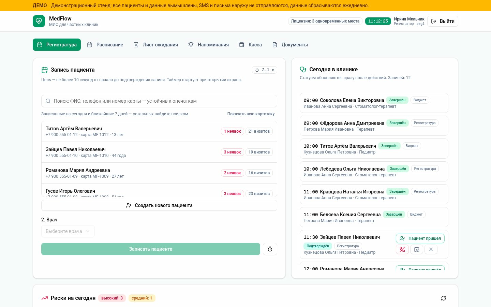
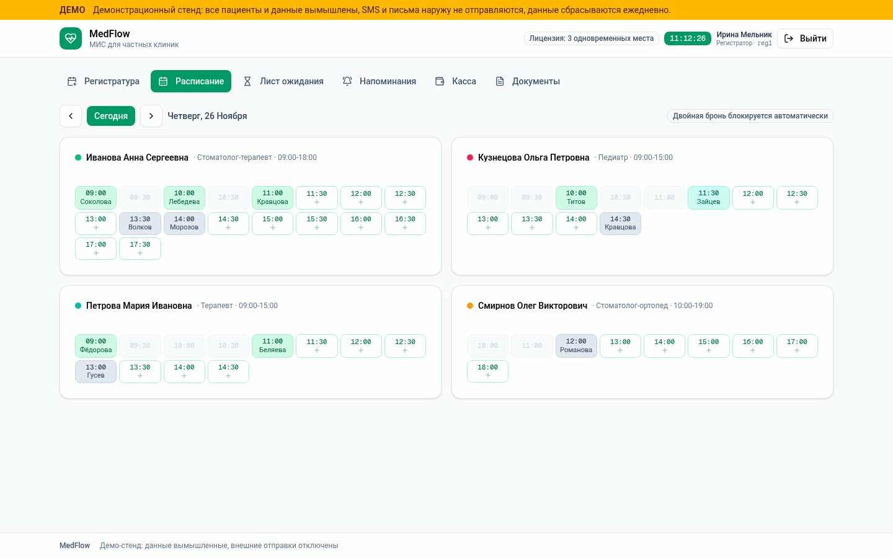
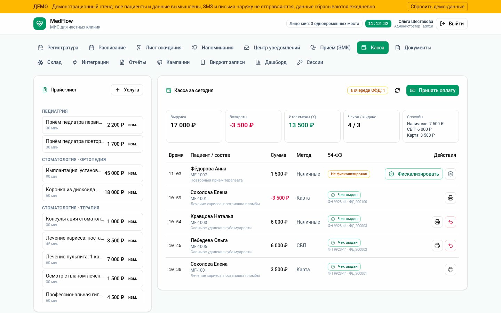
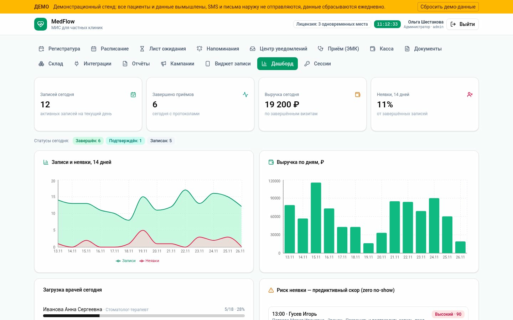

# MedFlow — медицинская информационная система для частных клиник

> **Исходный код доступен только для просмотра и оценки. Это не открытый код.**
> Использование, развёртывание, копирование, изменение и обучение ИИ запрещены. Условия — в [LICENSE](LICENSE).
> © 2026 Tony Genenncher.

MedFlow — моё портфолио-проект: веб-система для клиники, от записи пациента до кассы, ЭМК и отчётов. Я собрал её с помощью ИИ-инструментов (вайбкодинг) и сам вёл постановку задач, ревью, проверку запуском и приёмку. Для меня важна не скорость генерации, а то, чтобы всё было проверено: ниже приведены только те цифры, которые подтверждены прогоном (логи лежат в [docs/test-results](docs/test-results)).

В репозитории только демо-данные: все пациенты, врачи, телефоны и e-mail вымышленные, внешние отправки (SMS, MAX, почта, касса, ИИ) в демо заменены заглушками.

## Скриншоты (демо, вымышленные данные)

| Регистратор: у роли 6 вкладок из 15 | Расписание врачей |
|---|---|
|  |  |
| **Касса, 54-ФЗ** | **Дашборд руководителя** |
|  |  |

Публичный виджет онлайн-записи: [docs/screenshots/5-public-booking.svg](docs/screenshots/5-public-booking.svg).

## Стек

Next.js 16 (App Router), React, TypeScript, Tailwind CSS и shadcn/ui, Prisma 6, PostgreSQL 17, Vitest. Один код работает в двух режимах: `APP_MODE=production` и `APP_MODE=demo`. Для развёртывания подготовлены Docker, Caddy и скрипты резервного копирования (см. «Ограничения»). Около 35 тыс. строк TypeScript, 47 моделей данных, 13 миграций, 60 API-маршрутов.

## Что умеет

- **Рабочие процессы клиники:** запись и расписание врачей, лист ожидания с автопредложением освободившегося слота, карточка пациента, ЭМК с шаблонами протоколов и МКБ-10, документы по шаблонам, склад, ДМС-полисы, напоминания, кампании, виджет онлайн-записи для сайта клиники, выгрузка в 1С файлом.
- **Роли и права (RBAC):** пять ролей, одна матрица прав и для меню, и для проверок на сервере; можно переопределить через `RBAC_OVERRIDES`. Описание — [docs/ROLES.md](docs/ROLES.md).
- **2FA (TOTP)** по умолчанию для администратора, регистратора, врача и руководителя; вход через корпоративный SSO (OIDC); атомарные счётчики попыток, блокировка по логину и IP, асинхронный scrypt.
- **Неизменяемый журнал аудита:** триггер в базе запрещает UPDATE, DELETE и TRUNCATE; отдельная роль БД для приложения — [deploy/postgres/app-role.sql](deploy/postgres/app-role.sql). Сотрудника нельзя удалить, только деактивировать.
- **152-ФЗ:** согласия на обработку ПДн с версиями текста, журнал обращений к ПДн, полное обезличивание пациента, ссылки пациента с подписью, сроком жизни и отзывом, маскирование ПДн в логах.
- **ИИ с псевдонимизацией:** черновик протокола приёма; ФИО, телефоны, СНИЛС, полис и номер карты заменяются псевдонимами до обращения к модели; внешняя модель вызывается только при `LLM_EXTERNAL_ALLOWED`; врач проверяет и подтверждает текст.
- **Касса и АТОЛ Онлайн (54-ФЗ):** оплата с ключом идемпотентности, возврат только по выданному чеку, лимиты суммы и скидки, очередь фискализации с повторами.
- **Мессенджер МАКС:** напоминания и подтверждение записи, в том числе предложение слота из листа ожидания.
- **Безопасность и эксплуатация:** CSP с nonce, лимиты запросов, защита виджета (captcha, проверка источника), метрики `/api/metrics` под токеном, JSON-логи, проверка `/api/health`, шифрованные бэкапы с пробным восстановлением, проверка окружения при старте.

## Что проверено

Прогон на реальном PostgreSQL 17, данные только фейковые. Логи — в [docs/test-results](docs/test-results) (сделаны на рабочей версии до подготовки этой публикации; unit, db, tsc и audit я перезапустил на самой публичной копии).

| Проверка | Результат |
|---|---|
| unit-тесты (Vitest) | 118/118, перезапущено на этой копии |
| тесты на реальной БД | 67/67, перезапущено на этой копии |
| `tsc --noEmit` | 0 ошибок, перезапущено на этой копии |
| `npm audit` | 0 уязвимостей, перезапущено на этой копии |
| бэкап и восстановление (скрипт, фейковое S3) | 19/19 |
| HTTP-проверка прав по ролям, полей, поиска, 2FA, метрик, CSP | 51/51 для production и 51/51 для demo |
| HTTP-регрессия прошлых находок ревью | 16/16 и 13/13 |
| проверка алерта по `/api/health` | 5/5 |
| миграции: пустая БД и копия БД прошлой версии | 13/13, строки совпали |
| сквозной сценарий (регистратор и врач) | пройден |
| CSP в Chrome по всем вкладкам пяти ролей | 0 нарушений, XSS-векторы заблокированы |

## Ограничения

Пишу прямо, чего здесь нет:

- **ЕГИСЗ/РЭМД, лаборатории, ДМС-реестры и телефония (CTI) работают только в симуляторе:** есть очереди, модели данных и интерфейс, но боевых подключений нет.
- **АТОЛ Онлайн, SMS, МАКС, почта и внешние ИИ-модели** в тестах заменены заглушками. С реальными сервисами на живых данных я их не проверял.
- **Docker не проверен запуском:** `docker build`, `docker compose up` и восстановление бэкапа в контейнерах я не запускал (на машине, где велась работа, не было Docker). Конфигурация проверена только чтением и валидаторами: `docker compose config`, `caddy validate`, запуск сервера с файловой системой только для чтения.
- Политика CSP для стилей оставляет `unsafe-inline` (для скриптов он убран).
- Печатная форма только 025/у, нет интеграции со Штрих-М, дашборд руководителя не настраивается, 1С — выгрузка файлом без автообмена.
- Это не сертифицированная и не внедрённая система: аттестации по 152-ФЗ, реестра отечественного ПО и опыта промышленной эксплуатации нет.

## Как запустить демо локально

Только для оценки, на своём компьютере и только с демо-данными (разрешено [лицензией](LICENSE), п. 1.2). Нужны Node.js и PostgreSQL 17 (проверено на Node.js 24.22). Этот путь без Docker я проверил запуском.

```bash
npm ci
cp .env.demo.example .env.demo   # замените CHANGE_ME на любые значения
# в .env.demo задайте и DATABASE_URL=postgresql://user@127.0.0.1:5432/medflow_demo
set -a; . ./.env.demo; set +a
export APP_MODE=demo MEDFLOW_BUILD=demo ALLOW_INSECURE_HTTP=1 APP_URL=http://127.0.0.1:3000
npx prisma migrate deploy        # создаёт таблицы
npm run demo:seed                # вымышленные клиника, врачи, пациенты, записи
npm run build && PORT=3000 HOSTNAME=127.0.0.1 npm start
```

Откройте http://127.0.0.1:3000. Логины и пароль демо-учёток показаны на экране входа: `admin`, `reg1`, `doc1`, `mkt`, `head`. Для администратора включена 2FA, в демо код показывается на экране. Вариант через Docker описан в [README_DEPLOY.md](README_DEPLOY.md), но он не проверен запуском.

Тесты:

```bash
npm run typecheck
npm test                                  # unit, без базы
TEST_DATABASE_URL=postgresql://user@127.0.0.1:5432/medflow_test npx prisma migrate deploy
TEST_DATABASE_URL=postgresql://user@127.0.0.1:5432/medflow_test npm run test:db
```

## Структура

`src/app` — страницы и API, `src/lib` — бизнес-логика (права, касса, ПДн, ИИ, уведомления), `src/demo` — демо-данные, `prisma` — схема и миграции, `deploy` — Caddy, бэкапы, мониторинг, роль БД, `tests` — unit, db, http, backup, e2e, `docs` — роли и результаты проверок.

## Лицензия и честная оговорка

Исходный код опубликован как source-available: смотреть и оценивать можно, всё остальное запрещено. Публичный код технически можно скопировать; лицензия даёт юридическую основу для защиты, а не техническую. Подробности — в [LICENSE](LICENSE) и [NOTICE](NOTICE).
